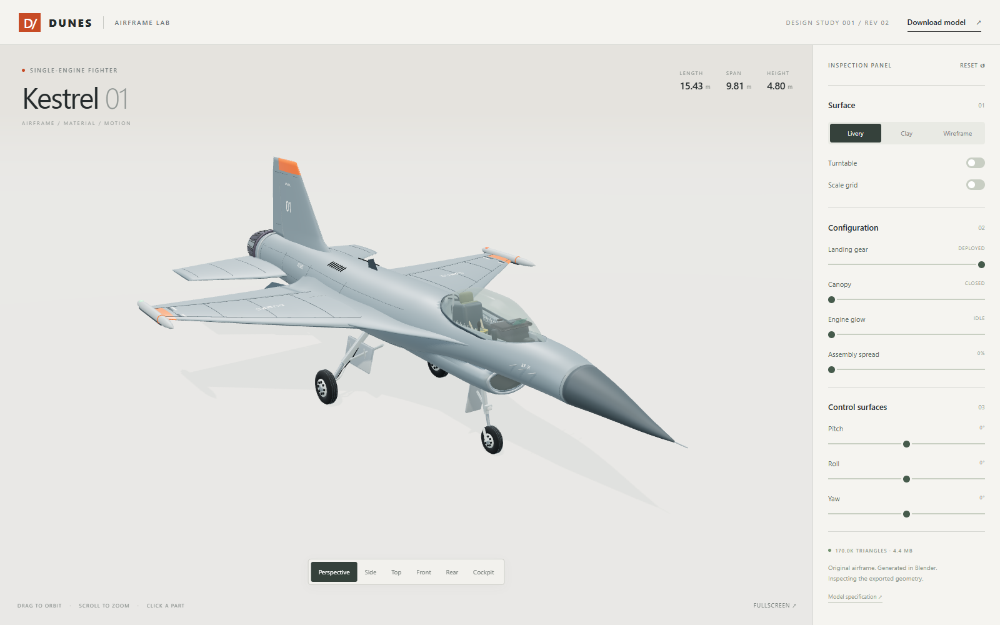

# Dunes

Driving sandbox and reproducible Blender vehicle modeling project for Trent.
Play: **https://tront.xyz/dunes/**.
Source: **https://github.com/TrentSterling/dunes**.

Starting point: [iotdatabase/glamis_game](https://github.com/iotdatabase/glamis_game),
imported at `22e58650c892cdae95a7e2f064bdffaefd277785`. Its history, game, vehicle
builders and license are preserved. `upstream` points to Glamis with pushing
disabled. Dunes has its own origin, identity and release workflow.

Jet Game (`../horde3d`) and Dustline (`../dustline`) are inspiration and future
integration references. The buggy pipeline is verified, and the first original
scripted jet is **Kestrel 01**, with its own Three.js inspection viewer.

The public game supports solo driving, computer sandrails and **Trystero
multiplayer**. Opening the game automatically joins the global lobby. No room
button or invitation is needed. Optionally share a named
room such as `https://tront.xyz/dunes/?room=trent-and-friends`. Cars, world settings
and tire tracks are shared directly between connected peers. Tracks are kept in
the active browsers; the hosted game has no permanent track server.

The driving game's HUD, menus, driver labels, name editor and live cockpit
displays use GPU glyphs. Press **P** to rename without restarting or reconnecting,
or use **M > Driver > Edit name**. The driver-side mirror's startup distortion
is fixed; it came from a cockpit mesh adjustment, not a damage system.
See [UI implementation and verification](docs/GPU-UI.md).

Click **Mute** below **Menu**, or press **U**, to silence the game immediately.
**M > Audio** has mute and master volume controls. Both settings stay saved on
this device; unmuting preserves the volume you chose. The U shortcut can be
changed in Key bindings and does not fire while editing your name.

The radar now draws its terrain, contours, compass and bot/player markers on
the GPU. **B** toggles it; the radar's **+ / -** buttons change its range.
Bots drive back when they wander away and roll upright through physics after a
rollover. They keep their positions when you change cars or teleport.
See [radar and bot verification](docs/RADAR-BOTS.md).

Name tags reject cars behind the camera and follow the current view. Camera and
mirror shaders warm up during loading; time changes reuse lighting resources.
See [view polish and measured performance](docs/VIEW-POLISH.md).

Large dust clouds render in a separate depth-aware pass capped at 960 x 540;
the world and GPU HUD retain full resolution. Helmeted riders use a CC0 humanoid
rig with an orange suit and seated steering pose. See [dust and rider notes](docs/DUST-RIDER.md).

The web release also
includes the [suspension viewer](https://tront.xyz/dunes/suspension.html) and
[Kestrel viewer](https://tront.xyz/dunes/jet.html). Kestrel is a model study;
JET GAME remains a separate project for future buggy-pipeline reuse.

Pushes to `main` publish through GitHub Pages. Run `npm run build:pages` to build
the same static files locally. See [deployment details](docs/DEPLOYMENT.md).

## Inspect the car suspension

With `npm start` running, open **http://localhost:5189/suspension.html**.

The rebuilt GLX Pro sits on a four-post inspection stand. Use independent wheel
travel, steering, cross-axle and axle cycles, or a single bump with adjustable
response and damping. Ghost the body, hide the wheels, show the joint overlay,
and switch between six camera views.

The viewer articulates rigid suspension arms and uprights and uses 170 separate
authored shock meshes. It keeps the original game assets and game rig unchanged.
Rear droop is limited to 150 mm because the authored rear linkage cannot follow
the game's 330 mm droop setting with fixed rod lengths on its neutral branch.
This is a kinematic inspection tool, not a validated vehicle dynamics model.

`npm run suspension:build` regenerates the split shocks from staged Blender
source and copies the existing rebuilt car. `npm run suspension:verify` checks
the viewer in isolated Chrome. See [rig details and evidence](docs/SUSPENSION-VIEWER.md).

## Inspect the jet

With `npm start` running, open **http://localhost:5189/jet.html**.



Orbit the actual exported model; open the canopy, retract the landing gear,
move the control surfaces and nozzle petals, or spread the assembly apart.
Six camera views include the cockpit. Livery, clay and wireframe modes expose
the model's shape and construction. The download button returns the complete GLB.

```powershell
# First-time Blender dependency setup, if not already done:
npm run vehicle:setup
npm run jet:build
npm run jet:render
# Keep npm start running in another terminal:
npm run jet:verify
```

- Editable Blender scene: `artifacts/vehicles/kestrel/kestrel.blend`
- Viewer asset: `assets/kestrel/kestrel.glb`
- Shape specification: `blender/kestrel/jet_spec.py`
- [Source guide, ViperOneOne references, and verification](docs/KESTREL-REFERENCE.md)

This is a model and inspection viewer. Flight physics and game integration are
the next stage. The GLB is checked in, so viewing does not require Blender.

## Play locally

Double-click `START-GAME.bat`, or:

```powershell
npm ci
npm start
```

Open **http://localhost:5189/**. WASD drives, C changes camera, M opens the menu.
The normal game initially uses the bundled upstream vehicle. Verification loads
the newly generated vehicle without replacing that baseline.

## Rebuild and inspect the buggy

Tested with **Blender 4.5.2 LTS** on Windows. The helper finds Blender 4.5 in
Program Files; set `BLENDER` or pass `--blender` for another executable.

```powershell
npm run vehicle:setup
npm run vehicle:build
npm run vehicle:render
npm run vehicle:bake
# Leave npm start running in another terminal:
npm run vehicle:verify
```

Setup installs pinned Pillow into `.tools/blender-python`, without modifying
Blender's global installation. Build stages source textures under `artifacts/`
because upstream part scripts repaint them. The editable scene packs its images.
Strict error handling and actual output validation are enabled.

Outputs:

- `artifacts/vehicles/glx-pro/sandrail.blend`: editable scene, packed textures.
- `artifacts/vehicles/glx-pro/sandcar.glb`: game model (bake updates this file).
- `artifacts/vehicles/glx-pro/sandcar.physics.json`: matching wheel/suspension data.
- `artifacts/vehicles/glx-pro/*receipt.json`: build and real-browser verification.
- `blender/trx_pro/renders/dunes_*.png`: studio inspection views.
- `artifacts/vehicles/glx-pro/game-*.png`: game captures of the rebuilt asset.

For a smaller modeling iteration:

```powershell
npm run vehicle:build -- --only body,chassis
```

That creates `artifacts/vehicles/glx-pro/parts/body_chassis.blend`, preserving the
complete game export. Missing upstream reference photos are optional for ordinary
inspection renders; they are required for exact photo-overlay comparisons.

## Read next

- [How the vehicle is built, and how to apply it to a jet](docs/VEHICLE-PIPELINE.md)
- [Current verification evidence](docs/VERIFICATION.md)
- [Original Glamis documentation and controls](docs/GLAMIS-UPSTREAM.md)
- [Upstream Blender source guide](blender/trx_pro/README.md)

The source is released under the upstream [Unlicense](UNLICENSE). Bundled
third-party components retain their licenses, listed in the original guide.
