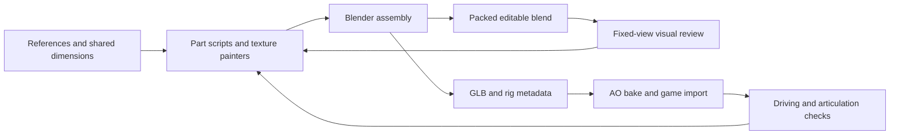

# The working modeling method

Trent's goal is to generate high-quality, editable game vehicles with code,
including other cars and eventually a proper jet. On November 3, 2026, the GLX
buggy was rebuilt from Python in Blender 4.5.2, rendered outside and inside, and
driven using its regenerated GLB in Chrome on the RTX 5070 Ti. This establishes
a concrete baseline for the workflow.

## What this repository demonstrates

The six main geometry scripts contain 12,519 lines altogether, including comments
and revision notes. `spec.py` records measurements from multiple reference views;
part scripts document corrections through rounds labeled r3, r4, r5 and r6.
The renderer includes fitted camera poses, calibrated studio lighting, comparison
images and silhouette overlays. This is a substantial authored modeling and
review effort. It does not establish that one prompt produced the final result.
The earlier unsuccessful modeling attempts have not been audited here.

Reference photos are excluded from the public repo. Rebuilding and inspecting
the car works; repeating the exact photo-overlay comparisons needs those images.

## Source map

Paths below are relative to `blender/trx_pro/` unless stated otherwise.

| File | Concrete job | Reuse for another model |
| --- | --- | --- |
| `spec.py` | Meter-scale wheelbase, track, tires, cage pivots, suspension points, driver eye | Shared dimensions and fixed attachment points |
| `common.py` | Bent tubes, revolved profiles, lofts, beveled solids, materials, UVs, grouping | Reusable shape operations and export conventions |
| `parts/body.py` | Structured panel grids, creases, rolled returns, 4 mm thickness, mirrored sides | Intentional silhouettes and surface transitions |
| `parts/chassis.py` | Tube paths, junctions, braces, mounting plates, lights, bolts | Named structural members with designed paths and radii |
| `parts/wheels.py` | Tire profiles, curved paddles, spokes, beadlock detail, sidewall maps | Revolved surfaces and radial repetition |
| `parts/suspension.py` | Wishbones, uprights, links, dampers and moving-member registration | Geometry tied to articulation endpoints |
| `parts/powertrain.py` | Engine pieces, turbo scrolls, belts, pulleys, pipes and hoses | Component-level assemblies from profiles and paths |
| `parts/interior.py` | Seats, upholstery, carbon trim, steering, knobs, switches and screens | Cockpit built and reviewed as its own subsystem |
| `textures/*.py` | Pillow/numpy livery, labels, screens, normals and roughness | Texture detail complementing geometry |
| `build.py` | Assembly, pivots, axis conversion, packed .blend, GLB and physics JSON | A stable agreement between authoring and game animation |
| `tools/bake_ao.py` | AO exported as the `_AO` vertex attribute | Preserve modeled depth in game shading |
| `tools/render.py` | Multi-view Cycles review and optional photo comparisons | Repeatable visual feedback |
| `../../public/js/gltf-sandrail.js` | Game loading, rig posing, material adjustments | Check the exported object in its target renderer |

## How the code actually models things

`common.tube()` rounds path corners, bevels a curve into a tube and converts it
to mesh. `common.lathe()` revolves a designed radial profile. `common.loft()`
skins matching cross-section rings. The body script adds bespoke quad grids,
controlled creases, rolled edges and material assignments. These operations
express intentional shapes at known dimensions.

Assembly joins stationary geometry into `Chassis_Mesh`, leaves wheel assemblies
under `Wheel_FL`/`FR`/`RL`/`RR`, and puts moving links at mid-span with a known
local axis. `BuildContext.segment()` registers geometry and endpoints together.
The build writes matching physics JSON; the browser poses those named nodes
from suspension and steering values. This ties model structure to animation.

Painted textures, bevel highlights, roughness and lighting contribute strongly
to the appearance. The runtime adds material adjustments and live cockpit
screens/mirrors. Studio renders and in-game views are separate quality checks.

## Applying this to a jet

Give the aircraft its own builder directory and specification. Reuse reviewed
generic helpers; keep buggy dimensions and its car-specific rig separate.

| Subsystem | Construction approach | Acceptance views |
| --- | --- | --- |
| Fuselage | Longitudinal stations with designed cross-sections, chines and intake transitions | Side, top, front, three-quarter |
| Wings and tail | Spanwise sections with thickness, sweep, taper, twist and separate control surfaces | Top silhouette, wing root, trailing edge |
| Canopy and cockpit | Explicit canopy profile, frame, recessed cockpit, seat and instruments | Side, oblique close-up, pilot eye |
| Intakes and exhaust | Open ducts with thickness, depth, lips and nozzles | Front and rear three-quarter |
| Landing gear | Struts, joints, doors and wheels with stable pivots | Deployed/retracted and underside |
| Finish | Panel boundaries, visible fasteners, restrained normal/roughness detail, coherent livery | Neutral and final material passes |
| Integration | Named control/gear nodes, engine positions, cockpit eye and scale data | Target renderer with animated controls |

Choose an aircraft design and reference set first. Lock silhouette and
proportions before small detail. Review multiple fixed views, then refine
subsystems separately. A jet needs flight behavior and runtime integration as
well as a model export. Those jet-specific milestones are future work.

## Repeatable local procedure

1. `npm run vehicle:setup` installs Pillow in the project tools folder.
2. `npm run vehicle:build` stages inputs and runs strict headless Blender.
3. Inspect the packed .blend and `npm run vehicle:render` fixed views.
4. Iterate a subsystem with `vehicle:build -- --only body,chassis` or another list.
5. Rebuild the full model, then `npm run vehicle:bake` for game AO.
6. With `npm start` running, use `npm run vehicle:verify`. It substitutes generated
   GLB/JSON in an isolated browser without replacing the bundled model.
7. Read receipts and inspect images. Node checks establish structural integrity;
   viewing the render establishes what the model looks like.

The assistant sandbox initially could not read downloaded Pillow files; normal
user access resolved that environment issue. Blender's Python and system Python
are separate environments. Setup uses Blender's interpreter for Pillow.

## Inspiration and eventual deployment

Jet Game lives in `C:/trontstack/horde3d`. Its local handoff describes a
JavaScript/Three.js WebGPU game with an arcade jet. Dustline lives in
`C:/trontstack/dustline`; its README and assembly notes describe Rust/wgpu/WASM
and procedural vehicle assemblies. These were read for context, without
retesting those games or modifying either repo.

https://tront.xyz/dunes/ is the eventual route. The inherited game includes a
Node WebSocket and persistent-track service. Static hosting alone would not
establish the existing multiplayer behavior.
